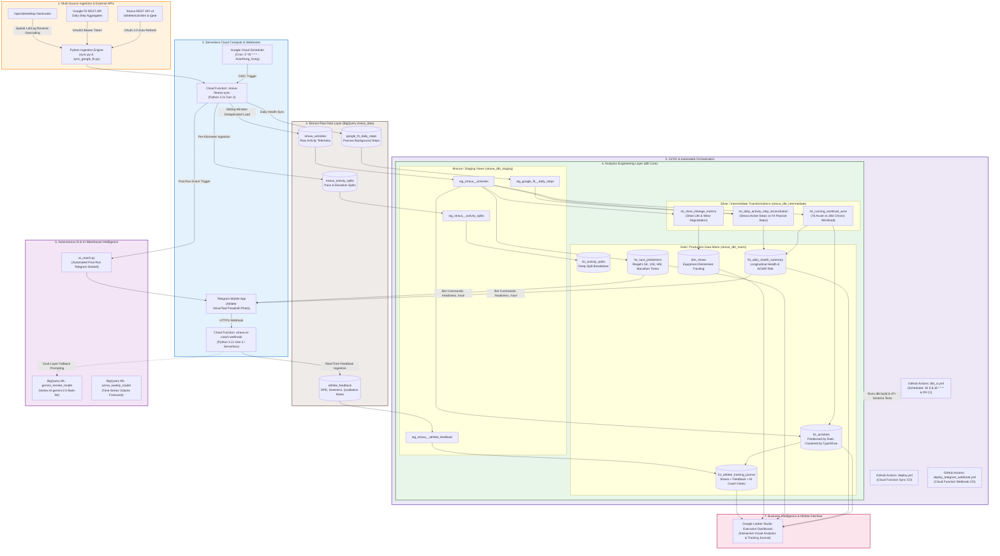

# 🏃‍♂️ Strava Fitness Analytics: Enterprise Cloud ELT, dbt Medallion Lakehouse & Autonomous GenAI Coaching Pipeline

[](https://github.com/notoriousclay/strava-fitness-analytics/actions)
[](https://cloud.google.com/)
[](https://cloud.google.com/bigquery)
[](https://www.getdbt.com/)
[-8E75C4?logo=google-gemini)](https://deepmind.google/technologies/gemini/)
[](https://telegram.org/)
[](https://datastudio.google.com/s/gXCMPgKJH48)
[](https://www.python.org/)

> 🔗 **Live Interactive Dashboard:** [Google Looker Studio Strava Dashboard](https://datastudio.google.com/s/gXCMPgKJH48)  
> 📖 **Comprehensive System Documentation:** [documentation.md](file:///c:/Users/My%20PC/strava-fitness-analytics/documentation.md)

---

## 📌 Executive Summary

Modern endurance athletes generate rich, high-frequency telemetry across disparate platforms: GPS devices (Strava), biometric background step counters (Google Fit), and qualitative post-workout perceptions (RPE, localized muscular soreness, and fatigue). Traditionally, these records exist in isolated silos or require expensive manual logging.

This project delivers an **end-to-end, enterprise-grade Data & AI Engineering Platform** that:
1. **Multi-Source Ingestion**: Autonomously extracts workout telemetry from the **Strava REST API** (OAuth 2.0 automatic token rotation) and daily background activity from the **Google Fit REST API**.
2. **Reverse Geocoding & Biomechanical Enrichment**: Enriches activities with physical location data via OpenStreetMap Nominatim and biomechanical metrics (step frequencies, cadence, pace formatting).
3. **dbt Medallion Architecture (Bronze → Silver → Gold)**:
   - **Bronze (Staging)**: Cleans, types, and standardizes raw Strava activities, kilometer splits, Google Fit daily step aggregates, and qualitative athlete debriefs.
   - **Silver (Intermediate)**: Calculates acute (7-day) vs chronic (28-day) workload ratios (**ACWR**), shoe cumulative mileage and depreciation thresholds, and cross-reconciles daily step counts against logged workouts.
   - **Gold (Marts)**: Serves production analytical marts (`fct_activities`, `fct_activity_splits`, `fct_daily_health_summary`, `fct_race_predictions`, `dim_shoes`, and `fct_athlete_training_journal`) enforced with **47+ automated data quality tests**.
4. **Predictive Analytics (BigQuery ML)**:
   - **Riegel's Endurance Formula**: Models projected race times across 5K, 10K, Half-Marathon, and Marathon based on rolling peak athletic performances.
   - **ARIMA_PLUS Time-Series Forecasting**: Detects longitudinal volume trends and automated seasonality breaks.
5. **Autonomous AI Coach & Human-in-the-Loop Feedback (Telegram Webhook)**:
   - Serverless Cloud Functions Gen 2 HTTP webhook receiving real-time Telegram athlete notes, treadmill console OCR images, and voice debriefs.
   - Synthesizes qualitative metrics (RPE, soreness location, fatigue level) directly into BigQuery (`athlete_feedback`).
   - Resilient GenAI engine with dual-tier fallback: direct Gemini API with automatic failover to BigQuery ML's native `gemini_remote_model`.
6. **Triple-Scheduled Serverless Orchestration**:
   - Google Cloud Scheduler executes ingestion every 8 hours (`0 */8 * * *`).
   - GitHub Actions CI/CD automatically triggers `dbt build` 30 minutes later (`30 0,8,16 * * *`), keeping all data marts fresh with zero infrastructure cost.
7. **Business Intelligence**: Visualizes acute-to-chronic injury risk zones, training volume distributions, equipment lifespan, and the interactive **Athlete Training Journal** in Google Looker Studio.

---

## 🏗️ Master Architecture Flowchart



---

## 🚀 Key Highlights & Architectural Features

### 1. dbt Medallion Modeling
- Implemented in `dbt_strava/` with clean Bronze (Staging), Silver (Intermediate), and Gold (Marts) structure.
- **47+ automated dbt data quality tests** passing in CI on every push and daily schedule.
- Advanced metrics: **Acute-to-Chronic Workload Ratio (ACWR)**, shoe depreciation lifecycle, active vs passive step reconciliation, and Riegel race prediction algorithms.

### 2. Autonomous Telegram AI Coach & Inbound Webhook
- **Serverless Cloud Function Gen 2** (`strava-ai-coach-webhook`) receiving athlete voice debriefs, treadmill console OCR photos, and text messages.
- Real-time qualitative data extraction (RPE, soreness, fatigue) ingested straight into BigQuery `athlete_feedback`.
- Instant athlete commands: `/readiness` (ACWR injury hazard status) and `/race` (projected 5K, 10K, Half, and Marathon times).
- Dual-layer GenAI resilience: direct Google Gemini API with seamless failover to native BigQuery ML `gemini_remote_model`.

### 3. Serverless Zero-Cost Cloud Orchestration
- **Cloud Scheduler** runs daily sync 3 times a day (`0 */8 * * *`).
- **GitHub Actions** runs `dbt build` 30 minutes later (`30 0,8,16 * * *`).
- **100% Free Tier**: Operates at **$0.00 / month** across GCP Cloud Functions, BigQuery, and GitHub Actions.

---

## 🏃 Quickstart & Local Setup

```bash
# 1. Clone the repository
git clone https://github.com/notoriousclay/strava-fitness-analytics.git
cd strava-fitness-analytics

# 2. Set up virtual environment
python -m venv venv
venv\Scripts\activate

# 3. Install dependencies
pip install -r requirements.txt

# 4. Configure .env file
# Fill in STRAVA_*, TELEGRAM_*, GEMINI_*, and GCP_* credentials

# 5. Run dbt build
cd dbt_strava
dbt deps --profiles-dir .
dbt build --profiles-dir . --target dev
```

For full system architecture details, query schemas, and runbooks, read [documentation.md](file:///c:/Users/My%20PC/strava-fitness-analytics/documentation.md).
