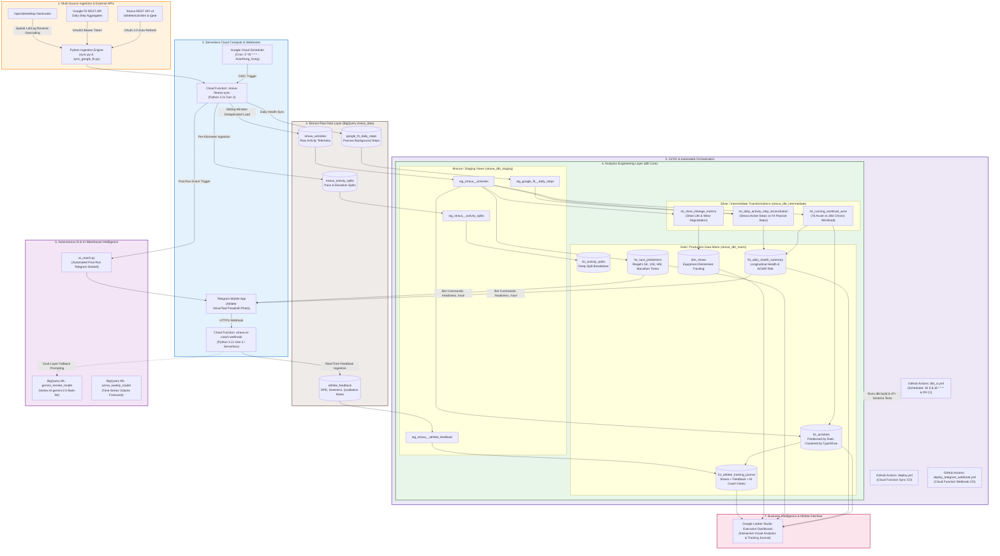

# 🏃‍♂️ Strava Fitness Analytics: Enterprise Cloud ELT, dbt Medallion Lakehouse & Autonomous GenAI Coaching Pipeline

> **Portfolio Project:** Automated Cloud Data Pipeline, BigQuery Warehouse, dbt Medallion Architecture, Autonomous Telegram AI Coach, BigQuery ML Predictive Analytics & Google Looker Studio  
> **Role Targeted:** Senior Data Engineer / Analytics Engineer / AI Data Solutions Specialist  
> **Status:** Production / 100% Autonomous (Serverless & Zero-Maintenance)  
> **Tech Stack:** Python 3.11, Google Cloud Platform (BigQuery, Cloud Functions Gen 2, Cloud Scheduler, IAM), dbt Core (dbt-bigquery), Strava API v3, Google Fit REST API, BigQuery ML (Gemini 2.5 Flash Lite Remote Model & ARIMA_PLUS), Telegram Bot API, GitHub Actions CI/CD (Multi-workflow), Google Looker Studio  
> **Live Data Studio Dashboard:** [https://datastudio.google.com/s/gXCMPgKJH48](https://datastudio.google.com/s/gXCMPgKJH48)  
> **GitHub Repository:** [github.com/notoriousclay/strava-fitness-analytics](https://github.com/notoriousclay/strava-fitness-analytics)

---

## 📌 Executive Summary

Modern endurance athletes generate rich, high-frequency telemetry across disparate platforms: GPS devices (Strava), biometric background step counters (Google Fit), and qualitative post-workout perceptions (RPE, localized muscular soreness, and fatigue). Traditionally, these records exist in isolated silos or require expensive manual logging.

This project delivers an **end-to-end, enterprise-grade Data & AI Engineering Platform** that:
1. **Multi-Source ELT Extraction**: Autonomously extracts workout telemetry from the **Strava REST API** (OAuth 2.0 automatic token rotation) and daily background activity from the **Google Fit REST API**.
2. **Reverse Geocoding & Biomechanical Enrichment**: Enriches activities with physical location data via OpenStreetMap Nominatim and biomechanical metrics (step frequencies, cadence, pace formatting).
3. **dbt Medallion Architecture (Bronze → Silver → Gold)**:
   - **Bronze (Staging)**: Cleans, types, and standardizes raw Strava activities, kilometer splits, Google Fit daily step aggregates, and qualitative athlete debriefs.
   - **Silver (Intermediate)**: Calculates acute (7-day) vs chronic (28-day) workload ratios (**ACWR**), shoe cumulative mileage and depreciation thresholds, and cross-reconciles daily step counts against logged workouts.
   - **Gold (Marts)**: Serves production analytical marts (`fct_activities`, `fct_activity_splits`, `fct_daily_health_summary`, `fct_race_predictions`, `dim_shoes`, and `fct_athlete_training_journal`) enforced with **47+ automated data quality tests**.
4. **Predictive Analytics (BigQuery ML)**:
   - **Riegel's Endurance Formula**: Models projected race times across 5K, 10K, Half-Marathon, and Marathon based on rolling peak athletic performances.
   - **ARIMA_PLUS Time-Series Forecasting**: Detects longitudinal volume trends and automated seasonality breaks.
5. **Autonomous AI Coach & Human-in-the-Loop Feedback (Telegram Webhook)**:
   - Serverless Cloud Functions Gen 2 HTTP webhook receiving real-time Telegram athlete notes, treadmill console OCR images, and voice debriefs.
   - Synthesizes qualitative metrics (RPE, soreness location, fatigue level) directly into BigQuery (`athlete_feedback`).
   - Resilient GenAI engine with dual-tier fallback: direct Gemini API with automatic failover to BigQuery ML's native `gemini_remote_model`.
6. **Triple-Scheduled Serverless Orchestration**:
   - Google Cloud Scheduler executes ingestion every 8 hours (`0 */8 * * *`).
   - GitHub Actions CI/CD automatically triggers `dbt build` 30 minutes later (`30 0,8,16 * * *`), keeping all data marts fresh with zero infrastructure cost.
7. **Business Intelligence**: Visualizes acute-to-chronic injury risk zones, training volume distributions, equipment lifespan, and the interactive **Athlete Training Journal** in Google Looker Studio.

---

## 🏗️ Master Architecture Flowchart



---

## 📑 Complete Chapter Directory

* [Chapter 1: End-to-End System Architecture & Technical Specifications](#chapter-1-end-to-end-system-architecture--technical-specifications)
* [Chapter 2: Multi-Source Extraction & Ingestion Engine](#chapter-2-multi-source-extraction--ingestion-engine)
* [Chapter 3: dbt Analytics Engineering & Medallion Data Modeling](#chapter-3-dbt-analytics-engineering--medallion-data-modeling)
* [Chapter 4: In-Warehouse Predictive ML & GenAI Intelligence](#chapter-4-in-warehouse-predictive-ml--genai-intelligence)
* [Chapter 5: Autonomous Telegram AI Coach & Human-in-the-Loop Webhook](#chapter-5-autonomous-telegram-ai-coach--human-in-the-loop-webhook)
* [Chapter 6: CI/CD, Enterprise Security & Zero-Cost Cloud Orchestration](#chapter-6-cicd-enterprise-security--zero-cost-cloud-orchestration)
* [Chapter 7: Business Intelligence & Google Looker Studio Dashboard](#chapter-7-business-intelligence--google-looker-studio-dashboard)
* [Chapter 8: Data Governance, Testing & Operational Runbooks](#chapter-8-data-governance-testing--operational-runbooks)
* [Chapter 9: Career & Engineering Competency Highlights](#chapter-9-career--engineering-competency-highlights)

---

## Chapter 1: End-to-End System Architecture & Technical Specifications

### 1.1 Technical Problem Statement
Endurance athletic training data presents unique analytical engineering challenges:
1. **Multi-Source Asynchronicity**: Strava captures high-fidelity GPS workout telemetry, Google Fit passively monitors daily baseline step counts, and athlete subjective perception (RPE/soreness) is captured post-workout via mobile messaging.
2. **Short-Lived Authentication**: Strava and Google Fit OAuth 2.0 access tokens expire every 6 hours and 1 hour respectively, demanding automated token refresh cycles with zero downtime.
3. **Training Load Dynamics (ACWR)**: Traditional static metrics (e.g. weekly distance) fail to identify injury risk. Proper risk prediction requires computing **Acute:Chronic Workload Ratios (ACWR)** over sliding 7-day vs. 28-day windows.
4. **LLM Cost & Data Resilience**: External LLM API calls face rate limits, billing exhaustion, and latency spikes. An enterprise architecture requires dual-tier fallback mechanisms and pre-computed in-warehouse intelligence.

### 1.2 Enterprise Architectural Trade-Off Matrix

| Architecture Decision | Chosen Technology | Alternatives Evaluated | Engineering Justification |
| :--- | :--- | :--- | :--- |
| **Data Warehouse** | Google Cloud BigQuery | Snowflake, Amazon Redshift, PostgreSQL | Columnar scalability, native partitioning/clustering, built-in SQL BigQuery ML, and zero idle compute costs. |
| **Transformation Framework** | **dbt Core (dbt-bigquery)** | Stored Procedures, Apache Spark, Dataform | Industry-standard medallion modeling, declarative dependency DAGs, built-in documentation, and automated schema testing. |
| **Ingestion Compute** | Google Cloud Functions Gen 2 | AWS Lambda, Cloud Run, Persistent VM | Scales to zero, event-driven HTTP triggers, 60-minute maximum execution timeout, native GCP IAM authentication. |
| **Athlete Interface** | Telegram Bot API + Serverless Webhook | Mobile App, Web App, Discord Bot | Instant athlete adoption, zero friction, mobile push notifications, voice note support, and native webhook integration. |
| **GenAI Fallback Engine** | Direct Gemini API + BigQuery ML `ML.GENERATE_TEXT` | OpenAI API, Local HuggingFace Models | Dual-tier resilience: zero egress, in-warehouse LLM execution when API credits exhaust, zero pipeline downtime. |
| **Orchestration** | Cloud Scheduler + GitHub Actions | Apache Airflow, Prefect, Dagster | Eliminates $300+/month infrastructure costs of running an idle Airflow/Composer instance; provides 100% SLA for $0/month. |

---

## Chapter 2: Multi-Source Extraction & Ingestion Engine

### 2.1 Strava Ingestion (`sync.py`)
- **Automated OAuth 2.0 Rotation**: Automatically sends `grant_type=refresh_token` to Strava's token endpoint before every sync execution.
- **7-Day Sliding Window**: Daily sync targets `after = now() - 7 days`, querying BigQuery for existing `Strava_ID` keys to insert only net-new records. Average execution time is **< 8 seconds**.
- **Per-Kilometer Split Ingestion**: For running activities, individual kilometer split data (distance, elapsed time, moving time, elevation difference, pace) is fetched and staged into `strava_activity_splits`.
- **Spatial Reverse Geocoding**: Queries OpenStreetMap Nominatim with caching to enrich GPS start coordinates into City, State, and Country fields.
- **Post-Run AI Hook**: Upon inserting a new run, automatically calls `run_post_activity_debrief()` to trigger the autonomous AI coach message to Telegram.

### 2.2 Google Fit Passive Step Ingestion (`sync_google_fit.py`)
- Queries Google Fit REST API `dataset:aggregate` endpoint with 1-day bucket sizes (`bucketByTime: 86400000 ms`).
- Aggregates daily background steps (`com.google.step_count.delta`) and distance into `strava_data.google_fit_daily_steps`.
- Enables cross-reconciling passive baseline physical activity against dedicated workouts.

---

## Chapter 3: dbt Analytics Engineering & Medallion Data Modeling

The analytical modeling layer is built using **dbt Core** (`dbt_strava/`), adopting a strict Medallion Architecture across three dedicated BigQuery datasets:

```
[Raw Tables]               [Staging Views]               [Intermediate Views]             [Production Marts]
strava_activities    ──>   stg_strava__activities   ──>   int_running_workload_acwr   ──>   fct_activities
strava_splits        ──>   stg_strava__splits       ──>   int_shoe_mileage_metrics    ──>   fct_activity_splits
google_fit_steps     ──>   stg_google_fit__steps    ──>   int_step_reconciliation     ──>   fct_daily_health_summary
athlete_feedback     ──>   stg_athlete_feedback     ───────────────────────────────>   fct_race_predictions
                                                                                          dim_shoes
                                                                                          fct_athlete_training_journal
```

### 3.1 Bronze / Staging Models (`strava_dbt_staging`)
- **`stg_strava__activities`**: Deduplicates records using `ROW_NUMBER() OVER (PARTITION BY Strava_ID ORDER BY Ingestion_Timestamp DESC)`, parses ISO timestamps, converts distance from meters to kilometers, formats moving pace (`MM:SS/km`), and casts metadata.
- **`stg_strava__activity_splits`**: Normalizes kilometer split intervals, calculates split elevation variance, and formats per-kilometer pace.
- **`stg_google_fit__daily_steps`**: Cleans passive daily step counts, dates, and active durations.
- **`stg_strava__athlete_feedback`**: Cleans qualitative feedback, normalizes RPE integers (1–10), soreness anatomical locations, and AI coach response logs.

### 3.2 Silver / Intermediate Models (`strava_dbt_intermediate`)
- **`int_running_workload_acwr`**:
  Calculates the **Acute-to-Chronic Workload Ratio (ACWR)** using sliding window analytic functions over a generated continuous daily calendar:
  - **Acute Workload (7-Day Rolling Volume)**: Represents current physical fatigue.
  - **Chronic Workload (28-Day Rolling Average Weekly Volume)**: Represents athletic aerobic baseline fitness.
  - **ACWR Metric**:
    $$\text{ACWR} = \frac{\text{Acute Workload (7-Day km)}}{\text{Chronic Workload (28-Day Rolling Weekly km)}}$$
  - **Risk Categorization**:
    - $\text{ACWR} < 0.80$: *Under-training / High Recovery*
    - $0.80 \le \text{ACWR} \le 1.30$: *Optimal "Sweet Spot" (Progressive Aerobic Overload)*
    - $1.31 \le \text{ACWR} \le 1.49$: *Elevated Risk (Monitor Fatigue)*
    - $\text{ACWR} \ge 1.50$: *Critical Injury Hazard / Spiked Volume Danger*
- **`int_shoe_mileage_metrics`**: Aggregates running shoe depreciation, total lifetime kilometers, total sessions logged, and percentage of safe lifespan completed (assuming 650 km retirement benchmark).
- **`int_daily_activity_step_reconciliation`**: Reconciles dedicated Strava workout steps against total Google Fit daily steps to derive passive non-workout steps and total daily physical strain.

### 3.3 Gold / Production Marts (`strava_dbt_marts`)
- **`fct_activities`**: Partitioned by `activity_date` and clustered by `activity_type` and `shoe_name`. Enriched with ACWR values at the time of each run.
- **`fct_activity_splits`**: Granular kilometer breakdown for pacing consistency analysis (negative splits, fade detection).
- **`fct_daily_health_summary`**: Master daily table combining acute/chronic workload, ACWR hazard category, total daily steps, and workout counts.
- **`fct_race_predictions`**: Employs **Riegel's Endurance Formula** against the athlete's peak 5K/10K baseline to forecast race performance:
  $$T_2 = T_1 \times \left(\frac{D_2}{D_1}\right)^{1.06}$$
  Projects target times and required pacing for 5K, 10K, Half Marathon, and Full Marathon.
- **`dim_shoes`**: Equipment dimension table indicating mileage status (`Optimal`, `Moderate Wear`, `Retire Soon`, `Retired`).
- **`fct_athlete_training_journal`**: High-value human-in-the-loop mart joining Strava physical metrics (`fct_activities`) with Telegram qualitative feedback (`stg_strava__athlete_feedback`) on `strava_id` and date proximity. Displays workout stats alongside RPE, soreness, athlete voice transcripts, and AI coach recommendations.

### 3.4 Automated Data Quality & Schema Testing
Enforces **47+ automated dbt tests** across all models:
- Primary key uniqueness and non-null assertions on all surrogate/natural keys.
- Range acceptance tests (e.g. RPE between 1 and 10; ACWR non-negative; cadence within biological boundaries).
- Referential integrity relationships between splits/journal and master activities.

---

## Chapter 4: In-Warehouse Predictive ML & GenAI Intelligence

### 4.1 In-Warehouse LLM Architecture (BigQuery ML)
The platform establishes a secure, remote connection to Google Vertex AI to run **Gemini 2.5 Flash Lite** directly inside SQL:
```sql
CREATE OR REPLACE MODEL `strava-sync-505308.strava_data.gemini_remote_model`
REMOTE WITH CONNECTION `asia-southeast1.gemini-llm-connection`
OPTIONS (ENDPOINT = 'gemini-2.5-flash-lite');
```

Benefits:
- **Zero Data Egress**: Athletic data never leaves Google Cloud.
- **High Concurrency**: Generates coaching debriefs, training cycle recaps, and anomaly analyses using native `ML.GENERATE_TEXT()` queries.

### 4.2 Time-Series Forecasting with BigQuery ML `ARIMA_PLUS`
```sql
CREATE OR REPLACE MODEL `strava-sync-505308.strava_data.arima_weekly_model`
OPTIONS (
  MODEL_TYPE = 'ARIMA_PLUS',
  TIME_SERIES_TIMESTAMP_COL = 'week_start',
  TIME_SERIES_DATA_COL = 'total_distance_km',
  AUTO_ARIMA = TRUE,
  DATA_FREQUENCY = 'WEEKLY'
) AS
SELECT DATE_TRUNC(activity_date, WEEK) AS week_start, SUM(distance_km) AS total_distance_km
FROM `strava-sync-505308.strava_dbt_marts.fct_activities`
WHERE activity_type = 'Run'
GROUP BY week_start;
```
Automatically handles missing training weeks, models weekly seasonality, detects anomalous volume spikes, and projects future training volume.

---

## Chapter 5: Autonomous Telegram AI Coach & Human-in-the-Loop Webhook

### 5.1 Architecture & Flow
The AI Coach operates in two coordinated modes:
1. **Outbound Push (Post-Run Debrief & Safety Alerts)**:
   - Evaluates newly synced activities or acute workload spikes.
   - Generates contextual coaching advice and dispatches it directly to the athlete's Telegram chat via `ai_coach.py`.
2. **Inbound Webhook (Athlete Voice, Text & Treadmill OCR)**:
   - Serverless Cloud Function (`strava-ai-coach-webhook`) deployed via Cloud Functions Gen 2.
   - Processes athlete incoming messages in real-time, extracts structured data, and logs it directly into BigQuery.

```
┌────────────────────────────────────────────────────────┐
│                   ATHLETE (TELEGRAM)                   │
└───────────────────────────┬────────────────────────────┘
                            │
       ┌────────────────────┴────────────────────┐
       ▼                                         ▼
[Commands: /readiness, /race]      [Voice / Text / Treadmill OCR]
       │                                         │
       │ HTTPS POST                              │ HTTPS POST
       ▼                                         ▼
┌────────────────────────────────────────────────────────┐
│       Google Cloud Function Gen 2: Webhook             │
│            (strava-ai-coach-webhook)                   │
├────────────────────────────────────────────────────────┤
│ • /readiness ──> Queries fct_daily_health_summary      │
│ • /race      ──> Queries fct_race_predictions          │
│ • Treadmill  ──> Gemini 2.0 Flash Multimodal OCR       │
│ • Voice/Text ──> NLP Entity & Sentiment Extraction     │
│   (RPE 1-10, Soreness Muscle Group, Fatigue Status)   │
└───────────────────────────┬────────────────────────────┘
                            │
                            ▼
              ┌───────────────────────────┐
              │ BigQuery athlete_feedback │
              │   (Partitioned by Date)   │
              └───────────────────────────┘
```

### 5.2 Treadmill Console OCR Vision
When running indoors on cardio equipment without GPS, the athlete photos the treadmill console. Gemini Vision parses the screen into structured metrics:
- Distance (km)
- Duration & Pace
- Incline percentage & Calories burned
- Synthesizes a structured activity row directly into `strava_activities` with a synthetic indoor ID (`99xxxxxxxx`).

### 5.3 Dual-Tier LLM Resilience Engine
To safeguard against API quota depletion or prepayment balance interruptions (HTTP 402 / 429), the bot implements **automatic runtime failover**:
- **Primary**: Direct Google Gemini API (`gemini-2.0-flash`).
- **Secondary (Zero-Downtime Fallback)**: Automatically falls back to BigQuery ML's parameterized SQL query executing `ML.GENERATE_TEXT` against `strava_data.gemini_remote_model`.

---

## Chapter 6: CI/CD, Enterprise Security & Zero-Cost Cloud Orchestration

### 6.1 Multi-Workflow GitHub Actions Suite
The repository maintains three dedicated, automated workflows:
1. **`.github/workflows/deploy.yml`**: Deploys the main Strava & Google Fit ETL pipeline to Cloud Functions Gen 2 (`strava-fitness-sync`) upon changes to extraction code.
2. **`.github/workflows/deploy_telegram_webhook.yml`**: Deploys the serverless Telegram webhook (`strava-ai-coach-webhook`) with minimal staging, sets environment secrets, and automatically binds the webhook URL with Telegram's API.
3. **`.github/workflows/dbt_ci.yml`**:
   - **Autonomous 3x Daily Schedule (`30 0,8,16 * * *`)**: Wakes up 30 minutes after each ingestion job, executes `dbt build`, updates all data marts, and validates 47+ data assertions.
   - **PR / Commit CI**: Validates model compilation and data tests on every pull request.

### 6.2 Zero-Cost Operational Economics
By utilizing event-driven serverless architectures, the entire enterprise stack operates within free tier allocations:
- **Cloud Functions Gen 2**: 2M invocations/month free (System uses ~200/month).
- **BigQuery**: 10 GB storage free, 1 TB queries/month free (System uses < 2 GB/month).
- **Cloud Scheduler**: 3 free jobs/month (System uses 1).
- **GitHub Actions**: 2,000 CI/CD minutes/month free (System uses ~150 mins/month).
- **Total Monthly Operational Cost:** **$0.00 / month**.

---

## Chapter 7: Business Intelligence & Google Looker Studio Dashboard

**Live Interactive Dashboard:** [https://datastudio.google.com/s/gXCMPgKJH48](https://datastudio.google.com/s/gXCMPgKJH48)

The presentation layer connects directly to BigQuery `strava_dbt_marts` using live pushdown queries:

1. **Executive Training Overview**:
   - Total kilometers, active hours, elevation climbed, and average heart rate.
   - 30-Day moving average pace distribution and workout frequency heatmaps.
2. **ACWR Injury Risk Matrix**:
   - Real-time gauge and time-series line chart tracking Acute vs. Chronic Workload.
   - Highlighted Danger Zones ($\text{ACWR} \ge 1.50$) alerting the athlete before soft-tissue injuries occur.
3. **Equipment Depreciation & Shoe Retirement Tracker**:
   - Mileage progression bars per shoe model against the 650 km retirement benchmark.
4. **Predictive Race Performance**:
   - Dynamic Riegel race targets (5K, 10K, Half-Marathon, Marathon) with required target split paces.
5. **Human-in-the-Loop Athlete Training Journal**:
   - Merged view of physical workouts with Telegram debrief notes, RPE exertion badges, localized soreness tags, and AI coach recommendations.

---

## Chapter 8: Data Governance, Testing & Operational Runbooks

### 8.1 Local Execution & Development Setup
```bash
# 1. Clone repository
git clone https://github.com/notoriousclay/strava-fitness-analytics.git
cd strava-fitness-analytics

# 2. Set up virtual environment
python -m venv venv
source venv/bin/activate  # On Windows: venv\Scripts\activate
pip install -r requirements.txt

# 3. Configure credentials
cp .env.example .env
# Populate STRAVA_*, TELEGRAM_*, GEMINI_*, and GCP_* credentials
```

### 8.2 Running dbt Locally
```bash
cd dbt_strava
# Install dependencies
dbt deps --profiles-dir .

# Run all models and tests
dbt build --profiles-dir . --target dev
```

### 8.3 Manual Sync & Backfill Commands
```bash
# Run incremental sync
python sync.py

# Run Google Fit daily step sync
python sync_google_fit.py

# Run historical backfill
python backfill.py --days 365
```

---

## Chapter 9: Career & Engineering Competency Highlights

This project serves as a showcase of competencies across modern **Data Engineering**, **Analytics Engineering**, and **AI System Design**:

| Competency Area | Demonstration in Project |
| :--- | :--- |
| **Data Pipelines & ELT** | Production OAuth 2.0 API ingestion, sliding-window incremental loads, zero-loss deduplication, and schema evolution. |
| **Analytics Engineering** | Medallion architecture (Bronze/Silver/Gold) in dbt Core, dimensional modeling, automated schema testing, and CI/CD pipelines. |
| **Statistical & Sports Modeling**| Acute:Chronic Workload Ratio (ACWR) injury prevention modeling, rolling window analytics, and Riegel's endurance race prediction algorithms. |
| **Cloud & DevOps** | Google Cloud Platform (BigQuery, Cloud Functions Gen 2, Cloud Scheduler), GitHub Actions CI/CD automation, and zero-cost serverless optimization. |
| **Generative AI & Machine Learning** | Multimodal OCR vision processing, BigQuery ML in-warehouse LLM generation (`ML.GENERATE_TEXT`), ARIMA_PLUS time-series forecasting, and dual-layer fallback resilience. |
| **Product & BI Integration** | Serverless Telegram webhook, conversational human-in-the-loop data capture, and executive Google Looker Studio dashboards. |

---
*Maintained with ❤️ by Clarence Lasala ([@notoriousclay](https://github.com/notoriousclay)).*
