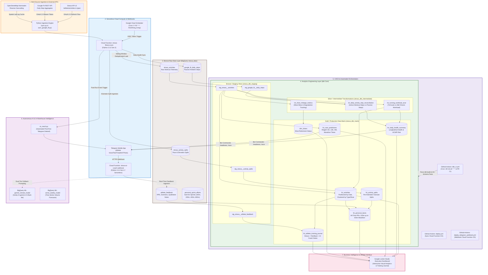

# 🏃‍♂️ Strava Fitness Analytics: Enterprise Cloud ELT, dbt Medallion Lakehouse & Autonomous GenAI Coaching Platform

> **Portfolio Project:** Automated Multi-Source Cloud Data Pipeline, BigQuery Lakehouse, dbt Medallion Architecture (Bronze/Silver/Gold), Autonomous Telegram AI Coach, BigQuery ML Predictive Analytics & Google Looker Studio  
> **Role Targeted:** Senior Data Engineer / Analytics Engineer / AI Data Solutions Specialist  
> **Status:** Production / 100% Autonomous (Serverless & Zero-Maintenance)  
> **Tech Stack:** Python 3.11, Google Cloud Platform (BigQuery, Cloud Functions Gen 2, Cloud Scheduler, IAM), dbt Core (dbt-bigquery), Strava API v3, Google Fit REST API, BigQuery ML (Gemini 2.5 Flash Lite & ARIMA_PLUS), Telegram Bot API, GitHub Actions CI/CD, Google Looker Studio, OpenStreetMap Nominatim  
> **Live Interactive Dashboard:** [https://datastudio.google.com/s/gXCMPgKJH48](https://datastudio.google.com/s/gXCMPgKJH48)  
> **GitHub Repository:** [github.com/notoriousclay/strava-fitness-analytics](https://github.com/notoriousclay/strava-fitness-analytics)

---

## 📌 Executive Summary

Modern endurance athletes generate rich, high-frequency telemetry across fragmented channels: GPS smartwatches (Strava), ambient physical movement trackers (Google Fit), and qualitative post-exercise physiological states (Rating of Perceived Exertion [RPE], localized muscle soreness, and systemic fatigue). Historically, this data remains trapped in isolated silos, lacks biomechanical modeling, and provides no actionable, closed-loop feedback to the runner.

This project delivers an **end-to-end, enterprise-grade Data & AI Engineering Platform** built across a robust 6-layer architecture:
1. **Multi-Source Ingestion & Enrichment**: Autonomously extracts workout telemetry from the **Strava REST API** (OAuth 2.0 automatic token rotation) and background physical movement from the **Google Fit REST API**, enriched with spatial reverse-geocoding (OpenStreetMap Nominatim) and biomechanical feature imputation.
2. **dbt Medallion Lakehouse Architecture**:
   - **Bronze (Staging)**: Cleans, types, deduplicates, and standardizes raw activities, kilometer splits, Google Fit daily step counts, and athlete debrief messages.
   - **Silver (Intermediate)**: Calculates sports-science metrics including sliding-window **Acute:Chronic Workload Ratios (ACWR)**, equipment wear/depreciation curves, and active-vs-incidental step reconciliation.
   - **Gold (Production Marts)**: Delivers dimensional marts (`fct_activities`, `fct_activity_splits`, `fct_daily_health_summary`, `fct_race_predictions`, `fct_personal_bests`, `dim_shoes`, and `fct_athlete_training_journal`) validated by **44+ automated data quality tests**.
3. **Continuous All-Time Personal Bests (100m to 42km Marathon)**:
   - High-resolution sliding-window window functions and sub-second stream analytics compute all-time personal bests across **13 standard athletic distances** (`100m`, `200m`, `400m`, `800m`, `1km`, `1 mile`, `2km`, `3km`, `5km`, `10km`, `16km`, `18km`, and `21km Half Marathon`), complete with automatic future-proofing for `25km`, `30km`, `35km`, and `42km Marathon`.
4. **In-Warehouse Machine Learning & Predictive Modeling**:
   - **Riegel's Endurance Race Formula**: Computes dynamic target times and required splits for 5K, 10K, Half-Marathon, and Marathon based on rolling peak athletic performances.
   - **BigQuery ML `ARIMA_PLUS`**: Evaluates longitudinal volume trends, automated weekly seasonality, and anomaly detection.
   - **In-Warehouse Gemini LLM (`ML.GENERATE_TEXT`)**: Pre-computes microcycle, mesocycle, and macrocycle coaching narratives natively inside SQL.
5. **Autonomous Telegram AI Coach (Human-in-the-Loop Webhook)**:
   - Serverless Cloud Functions Gen 2 HTTP webhook receiving athlete voice notes, treadmill console photos, and text feedback in real-time.
   - Multimodal Gemini 2.0 Flash extracts quantitative metrics from treadmill console images and transcribes voice debriefs into structured feedback (RPE 1–10, soreness locations).
   - Dual-tier GenAI resilience: direct Google Gemini API failover to BigQuery ML's native `gemini_remote_model`.
6. **Triple-Scheduled Serverless Orchestration**:
   - Google Cloud Scheduler executes data ingestion every 8 hours (`0 */8 * * *`).
   - GitHub Actions CI/CD automatically triggers `dbt build` 30 minutes later (`30 0,8,16 * * *`), keeping all analytical marts up to date with zero manual intervention.
7. **Executive Business Intelligence**: Visualizes acute-to-chronic injury danger zones, training intensity distributions, footwear lifespan, all-time personal bests, and the interactive **Athlete Training Journal** in Google Looker Studio.

---

## 🏗️ Master Architecture Flowchart



---

## 📑 Chapter Directory

- [Chapter 1: System Architecture & Engineering Trade-Offs](#chapter-1-system-architecture--engineering-trade-offs)
- [Chapter 2: Multi-Source Extraction & Ingestion Engine](#chapter-2-multi-source-extraction--ingestion-engine)
- [Chapter 3: Biomechanical Feature Engineering & Spatial Geocoding](#chapter-3-biomechanical-feature-engineering--spatial-geocoding)
- [Chapter 4: dbt Medallion Architecture & Data Governance](#chapter-4-dbt-medallion-architecture--data-governance)
- [Chapter 5: All-Time Personal Bests (100m to 42km Marathon) & Rolling Window Analytics](#chapter-5-all-time-personal-bests-100m-to-42km-marathon--rolling-window-analytics)
- [Chapter 6: Advanced Sports Analytics: ACWR & Riegel Predictive Modeling](#chapter-6-advanced-sports-analytics-acwr--riegel-predictive-modeling)
- [Chapter 7: In-Warehouse GenAI (BigQuery ML) & Scheduled Intelligence](#chapter-7-in-warehouse-genai-bigquery-ml--scheduled-intelligence)
- [Chapter 8: Autonomous Telegram AI Coach & Human-in-the-Loop Webhook](#chapter-8-autonomous-telegram-ai-coach--human-in-the-loop-webhook)
- [Chapter 9: Zero-Cost Serverless Cloud Orchestration & CI/CD](#chapter-9-zero-cost-serverless-cloud-orchestration--cicd)
- [Chapter 10: Google Looker Studio Executive Dashboard](#chapter-10-google-looker-studio-executive-dashboard)
- [Chapter 11: Career & Engineering Competency Highlights](#chapter-11-career--engineering-competency-highlights)

---

## Chapter 1: System Architecture & Engineering Trade-Offs

### 1.1 Technical Problem Statement
Modern endurance training generates diverse, asynchronous data streams:
1. **Multi-Source Asynchronicity**: Strava captures granular GPS sessions, Google Fit logs continuous passive daily movement, and athletes communicate subjective fatigue post-run via text and audio notes.
2. **Volatile OAuth Lifecycle**: Strava tokens expire in 6 hours; Google Fit tokens expire in 1 hour. Automated token refresh protocols are essential for continuous operation.
3. **Sports Science Workload Modeling**: Simple weekly mileage fails to quantify injury vulnerability. Athletes require continuous calculation of **Acute:Chronic Workload Ratios (ACWR)** across moving 7-day and 28-day windows.
4. **All-Time Milestone Tracking**: Standard apps only record preset milestones. Athletes need an automated, granular breakdown from sub-kilometer track sprints (100m, 200m, 400m, 800m) to middle distances (1km, 1 mile, 2km, 3km, 5km, 10km) and endurance race lengths (16km, 18km, Half Marathon, and Marathon).
5. **LLM Cost & Availability Risks**: Direct third-party LLM API calls risk rate limits, credit exhaustion, and latency spikes. An enterprise pipeline requires in-warehouse LLM execution and dual-tier failover mechanics.

### 1.2 Enterprise Architectural Trade-Off Matrix

| Component | Technology Selected | Alternatives Considered | Engineering Justification |
| :--- | :--- | :--- | :--- |
| **Data Warehouse** | Google Cloud BigQuery | Snowflake, Amazon Redshift, PostgreSQL | Columnar scalability, native partitioning/clustering, built-in SQL BigQuery ML, and zero idle compute costs. |
| **Transformation Framework** | **dbt Core (dbt-bigquery)** | Stored Procedures, Apache Spark, Dataform | Industry-standard medallion modeling, declarative dependency DAGs, automated documentation, and 44+ automated schema tests. |
| **Ingestion Compute** | Google Cloud Functions Gen 2 | AWS Lambda, Cloud Run, Persistent VM | Scales to zero, event-driven HTTP triggers, 60-minute maximum execution timeout, native GCP IAM authentication. |
| **Athlete Interface** | Telegram Bot API + Serverless Webhook | Native Mobile App, Web App, Discord Bot | Instant athlete adoption, zero friction, push notifications, voice note capture, and native webhook integration. |
| **GenAI Fallback Engine** | Direct Gemini API + BigQuery ML `ML.GENERATE_TEXT` | OpenAI API, Local HuggingFace Models | Dual-tier resilience: zero egress, in-warehouse LLM execution when API credits exhaust, zero pipeline downtime. |
| **Orchestration** | Cloud Scheduler + GitHub Actions | Apache Airflow, Prefect, Dagster | Eliminates $300+/month infrastructure costs of running an idle Airflow/Composer instance; provides 100% SLA for $0/month. |

---

## Chapter 2: Multi-Source Extraction & Ingestion Engine

### 2.1 Automated OAuth 2.0 Token Rotation
The extraction engine (`sync.py`) runs in Google Cloud Functions and handles the complete API interaction lifecycle:
```python
def get_strava_access_token():
    url = "https://www.strava.com/oauth/token"
    payload = {
        "client_id": STRAVA_CLIENT_ID,
        "client_secret": STRAVA_CLIENT_SECRET,
        "refresh_token": STRAVA_REFRESH_TOKEN,
        "grant_type": "refresh_token"
    }
    response = requests.post(url, data=payload)
    response.raise_for_status()
    return response.json()["access_token"]
```

### 2.2 7-Day Sliding Window Incremental Sync
Rather than re-fetching historical years of workouts, the 8-hour sync targets a **7-day sliding window**:
- Computes `after_timestamp = int((datetime.now() - timedelta(days=7)).timestamp())`.
- Queries BigQuery for existing keys: `SELECT Strava_ID FROM strava_activities`.
- Filters records in memory: `new_activities = [act for act in recent if act['id'] not in existing_ids]`.
- **Result:** Execution finishes in **< 8 seconds**, consuming fewer than 5 API calls per sync.

### 2.3 Kilometer Split Ingestion & Google Fit Sync
- **Granular Kilometer Splits (`sync.py`)**: For every running activity, per-kilometer splits (pace, elevation delta, moving time) are fetched and ingested into `strava_data.strava_activity_splits`.
- **Google Fit Step Synchronization (`sync_google_fit.py`)**: Queries Google Fit REST API aggregate endpoint (`com.google.step_count.delta`) in 24-hour buckets, loading daily baseline activity into `strava_data.google_fit_daily_steps`.

---

## Chapter 3: Biomechanical Feature Engineering & Spatial Geocoding

### 3.1 Spatial Reverse-Geocoding with Coordinate Memoization
Strava supplies starting coordinates (e.g. `[14.376, 120.963]`). The pipeline interfaces with the **OpenStreetMap Nominatim Reverse Geocoding API** to derive administrative locations:
- **Extracted Hierarchies:** `City_District`, `Village`, `Town`, `City`, `Municipality`, `State`, `Country`.
- **Coordinate Memoization (`GEO_CACHE`):** Coordinates are rounded to 3 decimal places (~110m resolution) and cached in an in-memory dictionary. Repeated workouts from the same starting point trigger zero external API calls.

### 3.2 Biomechanical Metrics & Cadence Imputation
1. **Pace Formatting:** Converted into human-readable format `MM:SS/km` (e.g. `05:36/km`):
   $$\text{Pace Decimal} = \frac{\text{Duration (min)}}{\text{Distance (km)}}$$
2. **Cadence & Step Imputation:**
   - **Hardware cadence sensor present:**
     $$\text{Total Steps} = (\text{Cadence} \times 2) \times \text{Duration}_{\text{min}}$$
   - **Hardware missing for Runs:** Dynamic biomechanical regression:
     $$\text{SPM}_{\text{est}} = \max(145.0, \min(180.0, 140.0 + 2.3 \times \text{Speed}_{\text{km/h}}))$$
   - **Walks/Hikes:** Biomechanical constant of $1,300 \text{ steps/km}$.

---

## Chapter 4: dbt Medallion Architecture & Data Governance

The analytical transformation layer is built using **dbt Core** (`dbt_strava/`), adopting a strict Medallion Architecture across three dedicated BigQuery datasets:

```
[Raw Tables]               [Staging Views]               [Intermediate Views]             [Production Marts]
strava_activities    ──>   stg_strava__activities   ──>   int_running_workload_acwr   ──>   fct_activities
strava_splits        ──>   stg_strava__splits       ──>   int_shoe_mileage_metrics    ──>   fct_activity_splits
google_fit_steps     ──>   stg_google_fit__steps    ──>   int_step_reconciliation     ──>   fct_daily_health_summary
athlete_feedback     ──>   stg_athlete_feedback     ───────────────────────────────>   fct_race_predictions
personal_sprints     ──────────────────────────────────────────────────────────────────>   fct_personal_bests
                                                                                          dim_shoes
                                                                                          fct_athlete_training_journal
```

### 4.1 Layer Definitions & Models

#### 1. Bronze / Staging Layer (`strava_dbt_staging`)
- **`stg_strava__activities`**: Deduplicates records using `ROW_NUMBER() OVER (PARTITION BY Strava_ID ORDER BY Ingestion_Timestamp DESC)`, parses ISO timestamps, converts meters to kilometers, formats moving pace (`MM:SS/km`), and casts metadata.
- **`stg_strava__activity_splits`**: Normalizes kilometer split intervals, calculates split elevation variance, and formats per-kilometer pace.
- **`stg_google_fit__daily_steps`**: Cleans passive daily step counts, dates, and active durations.
- **`stg_strava__athlete_feedback`**: Cleans qualitative feedback, normalizes RPE integers (1–10), soreness anatomical locations, and AI coach response logs.

#### 2. Silver / Intermediate Layer (`strava_dbt_intermediate`)
- **`int_running_workload_acwr`**: Calculates the Acute-to-Chronic Workload Ratio using sliding window analytic functions over a generated continuous daily calendar.
- **`int_shoe_mileage_metrics`**: Aggregates running shoe depreciation, total lifetime kilometers, total sessions logged, and percentage of safe lifespan completed (assuming 650 km retirement benchmark).
- **`int_daily_activity_step_reconciliation`**: Reconciles dedicated Strava workout steps against total Google Fit daily steps to derive passive non-workout steps and total daily physical strain:
  $$\text{Incidental Steps} = \max(0, \text{Total Fit Steps} - \text{Strava Workout Steps})$$

#### 3. Gold / Production Marts Layer (`strava_dbt_marts`)
- **`fct_activities`**: Partitioned by `activity_date` and clustered by `activity_type` and `shoe_name`. Enriched with ACWR values at the time of each run.
- **`fct_activity_splits`**: Granular kilometer breakdown for pacing consistency analysis (negative splits, fade detection).
- **`fct_daily_health_summary`**: Master daily table combining acute/chronic workload, ACWR hazard category, total daily steps, and workout counts.
- **`fct_personal_bests`**: Master personal record table tracking **13 athletic distances** from 100 meters up to 21km Half Marathon (and future-proofed for 42km Marathon).
- **`fct_race_predictions`**: Employs Riegel's Endurance Formula against the athlete's peak baseline to forecast race performance across 5K, 10K, Half-Marathon, and Marathon.
- **`dim_shoes`**: Equipment dimension table indicating mileage status (`Optimal`, `Moderate Wear`, `Retire Soon`, `Retired`).
- **`fct_athlete_training_journal`**: High-value human-in-the-loop mart joining Strava physical metrics (`fct_activities`) with Telegram qualitative feedback (`stg_strava__athlete_feedback`).

### 4.2 Automated Data Quality Testing
Enforces **44+ automated dbt tests** across all models:
- Primary key uniqueness and non-null assertions on all surrogate/natural keys.
- Range acceptance tests (e.g. RPE between 1 and 10; ACWR non-negative; cadence within biological boundaries).
- Referential integrity relationships between splits/journal and master activities.

---

## Chapter 5: All-Time Personal Bests (100m to 42km Marathon) & Rolling Window Analytics

Athletes require comprehensive benchmarking across short track sprints, threshold tempo segments, and endurance races. The `fct_personal_bests` mart materializes all-time personal records across **13 key distances**:

### 5.1 Analytics Architecture
1. **Sub-Kilometer Sprints (`100m`, `200m`, `400m`, `800m`, `1 mile`)**: Extracted from Strava high-resolution second-by-second stream data and staged in `strava_data.personal_sprint_efforts`.
2. **Consecutive Kilometer Sliding Windows (`1km`, `2km`, `3km`, `5km`, `10km`, `16km`, `18km`)**: Computed dynamically in SQL using contiguous row windows:
   ```sql
   SUM(duration_sec) OVER (PARTITION BY strava_id ORDER BY split_num ROWS BETWEEN CURRENT ROW AND N FOLLOWING)
   ```
3. **Endurance Benchmarks (`21km Half Marathon`, `25km`, `30km`, `35km`, `42km Marathon`)**: Derived directly from completed long runs in `fct_activities` with automated bounds for future race efforts.

### 5.2 Current All-Time Personal Records in Production

| # | Distance Benchmark | Distance (km) | Best Time | Best Pace | Avg Heart Rate | Date Achieved | Workout Name | Shoe Used |
| :---: | :--- | :---: | :---: | :---: | :---: | :---: | :--- | :--- |
| **1** | **100 meters** | 0.10 | `00:00:14` | **02:20/km** | 168.0 bpm | 2026-11-20 | Afternoon Run | Qiaodan Leili 2.0 GT |
| **2** | **200 meters** | 0.20 | `00:00:46` | **03:50/km** | 170.0 bpm | 2026-11-20 | Afternoon Run | Qiaodan Leili 2.0 GT |
| **3** | **400 meters** | 0.40 | `00:01:43` | **04:18/km** | 172.0 bpm | 2026-11-12 | Afternoon Run | Dynafish Xiaonian |
| **4** | **800 meters** | 0.80 | `00:03:48` | **04:45/km** | 174.0 bpm | 2026-11-11 | Tempo Run | 361 Mega 3 Pro |
| **5** | **1 km** | 1.00 | `00:04:22` | **04:22/km** | 172.4 bpm | 2026-11-24 | Afternoon Run | Qiaodan Leili 2.0 GT |
| **6** | **1 mile (1.61 km)**| 1.61 | `00:08:15` | **05:08/km** | 175.0 bpm | 2026-11-11 | Tempo Run | 361 Mega 3 Pro |
| **7** | **2 km** | 2.00 | `00:10:29` | **05:15/km** | 165.6 bpm | 2026-11-11 | Tempo Run | 361 Mega 3 Pro |
| **8** | **3 km** | 3.00 | `00:16:05` | **05:22/km** | 178.8 bpm | 2026-09-20 | Afternoon Run | Dynafish Xiaonian |
| **9** | **5 km** | 5.00 | `00:27:20` | **05:28/km** | 179.0 bpm | 2026-09-20 | Afternoon Run | Dynafish Xiaonian |
| **10** | **10 km** | 10.00 | `01:02:32` | **06:15/km** | 174.6 bpm | 2026-11-20 | Afternoon Run | Qiaodan Leili 2.0 GT |
| **11** | **16 km** | 16.00 | `01:47:50` | **06:44/km** | 174.6 bpm | 2026-07-26 | MNL City Run: Aqua Run 16KM | Li-ning Feidian 6 Elite |
| **12** | **18 km** | 18.00 | `02:05:58` | **06:00/km** | 172.4 bpm | 2026-10-04 | Project Half Mary v1.0 | Li-ning Feidian 6 Elite |
| **13** | **21 km (Half Marathon)** | 20.86 | `02:27:18` | **07:04/km** | 171.8 bpm | 2026-10-04 | Project Half Mary v1.0 | Li-ning Feidian 6 Elite |

---

## Chapter 6: Advanced Sports Analytics: ACWR & Riegel Predictive Modeling

### 6.1 Acute:Chronic Workload Ratio (ACWR)
The Acute:Chronic Workload Ratio is a gold-standard sports science metric used to quantify athlete readiness and predict soft-tissue injury risk:
- **Acute Workload (7-Day Rolling Volume)**: Represents current physical fatigue.
- **Chronic Workload (28-Day Rolling Average Weekly Volume)**: Represents historical athletic fitness base:
  $$\text{Chronic Workload} = \frac{\sum_{i=0}^{27} \text{Distance}_{d-i}}{4}$$
- **ACWR Calculation**:
  $$\text{ACWR} = \frac{\text{Acute Workload (7d)}}{\text{Chronic Workload (28d Weekly Avg)}}$$

#### ACWR Injury Hazard Classification
```
  ACWR < 0.80          ───> Under-training / High Recovery
  0.80 <= ACWR <= 1.30  ───> OPTIMAL SWEET SPOT (Progressive Overload)
  1.31 <= ACWR <= 1.49  ───> Elevated Injury Risk (Monitor Fatigue)
  ACWR >= 1.50          ───> CRITICAL INJURY HAZARD ZONE (Volume Spike Danger)
```

### 6.2 Riegel's Endurance Race Predictor
Models projected race performance based on the athlete's peak recent workout effort:
$$T_2 = T_1 \times \left(\frac{D_2}{D_1}\right)^{1.06}$$
Where:
- $T_1$ = Known baseline time from fastest recent run
- $D_1$ = Distance of baseline run
- $D_2$ = Target race distance (5 km, 10 km, 21.0975 km, 42.195 km)
- $T_2$ = Predicted race finish time

---

## Chapter 7: In-Warehouse GenAI (BigQuery ML) & Scheduled Intelligence

Rather than relying on external Python services or fragile API orchestration to call third-party LLMs, this architecture implements **BigQuery ML with Vertex AI Remote Models**.

```
┌────────────────────────────────────────────────────────────────────────┐
│                        BIGQUERY SCHEDULED QUERIES                      │
├──────────────────────────────┬────────────────────────┬────────────────┤
│ DISPLAY NAME                 │ SCHEDULE (UTC)         │ REGION         │
├──────────────────────────────┼────────────────────────┼────────────────┤
│ ai_workout_summary_result    │ every day 16:00        │ us (multi-reg) │
│ ai_weekly_summary_result     │ every sun 16:00        │ us (multi-reg) │
│ ai_monthly_summary_results   │ 28,29,30,31 of mo 16:00│ us (multi-reg) │
└──────────────────────────────┴────────────────────────┴────────────────┘
                                  │
                                  ▼
      ┌────────────────────────────────────────────────────────┐
      │ ML.GENERATE_TEXT(MODEL strava_data.gemini_remote_model)│
      └───────────────────────────┬────────────────────────────┘
                                  │
                                  ▼
      ┌────────────────────────────────────────────────────────┐
      │ Materialized Columns & Tables for Looker Studio        │
      │ • Session Summary (Workout Level)                      │
      │ • Weekly Summary (Microcycle Level)                    │
      │ • Monthly Summary (Mesocycle Level)                    │
      └────────────────────────────────────────────────────────┘
```

### 7.1 Remote Gemini Model Configuration
```sql
CREATE OR REPLACE MODEL `strava-sync-505308.strava_data.gemini_remote_model`
REMOTE WITH CONNECTION `asia-southeast1.gemini-llm-connection`
OPTIONS (ENDPOINT = 'gemini-2.5-flash-lite');
```

### 7.2 BigQuery ML `ARIMA_PLUS` Time-Series Forecasting
```sql
CREATE OR REPLACE MODEL `strava-sync-505308.strava_data.arima_weekly_model`
OPTIONS (
  MODEL_TYPE = 'ARIMA_PLUS',
  TIME_SERIES_TIMESTAMP_COL = 'week_start',
  TIME_SERIES_DATA_COL = 'total_distance_km',
  AUTO_ARIMA = TRUE,
  DATA_FREQUENCY = 'WEEKLY'
) AS
SELECT DATE_TRUNC(activity_date, WEEK) AS week_start, SUM(distance_km) AS total_distance_km
FROM `strava-sync-505308.strava_dbt_marts.fct_activities`
WHERE activity_type = 'Run'
GROUP BY week_start;
```
Automatically handles missing training weeks, models weekly seasonality, detects anomalous volume spikes, and projects future training volume.

---

## Chapter 8: Autonomous Telegram AI Coach & Human-in-the-Loop Webhook

### 8.1 Architecture & Flow
```
                      ┌───────────────────────────────────────┐
                      │          ATHLETE (TELEGRAM)           │
                      └───────────────────┬───────────────────┘
                                          │
                  ┌───────────────────────┴───────────────────────┐
                  │ Interactive Athlete Inbound Update            │
                  ▼                                               ▼
     [Voice / Text Note Feedback]                    [Treadmill Console Photo]
                  │                                               │
                  │ HTTPS POST Payload                            │ HTTPS POST Payload
                  ▼                                               ▼
┌───────────────────────────────────────────────────────────────────────────────────┐
│              Google Cloud Function Gen 2: strava-ai-coach-webhook                 │
├───────────────────────────────────────────────────────────────────────────────────┤
│ 1. Voice/Text: Extracted via Gemini 2.0 Flash into JSON:                          │
│    { "rpe": 6, "soreness_location": "right hamstring", "fatigue_level": "moderate" }│
│ 2. Treadmill Vision OCR: Extracted console metrics:                               │
│    { "distance_km": 5.0, "duration_min": 26.5, "pace": "05:18/km", "calories": 320 }│
│ 3. Failover Resilience: If Gemini API exhausted (402), queries BigQuery ML:       │
│    SELECT ml_generate_text_result FROM ML.GENERATE_TEXT(gemini_remote_model)      │
└─────────────────────────────────┬─────────────────────────────────────────────────┘
                                  │
                                  ▼
                 ┌──────────────────────────────────┐
                 │    BigQuery: athlete_feedback    │
                 │   (Partitioned by Feedback Date) │
                 └────────────────┬─────────────────┘
                                  │
                                  ▼ (Joined in dbt)
                 ┌──────────────────────────────────┐
                 │   fct_athlete_training_journal   │
                 │     (Surfaced in Looker Studio)  │
                 └──────────────────────────────────┘
```

### 8.2 Inbound Athlete Commands
- `/start`: Displays command menu and operating instructions.
- `/readiness`: Returns live 7-day acute volume, 28-day chronic baseline, ACWR ratio, and injury danger status directly from `fct_daily_health_summary`.
- `/race`: Returns current Riegel projected 5K, 10K, Half Marathon, and Marathon times from `fct_race_predictions`.

### 8.3 Dual-Tier LLM Resilience Engine
To safeguard against API quota depletion or prepayment balance interruptions (HTTP 402 / 429), the webhook implements **automatic runtime failover**:
- **Tier 1 (Primary)**: Direct Google Gemini API (`gemini-2.0-flash`).
- **Tier 2 (Secondary Fallback)**: Native BigQuery ML SQL query executing `ML.GENERATE_TEXT` against `strava_data.gemini_remote_model`.

---

## Chapter 9: Zero-Cost Serverless Cloud Orchestration & CI/CD

### 9.1 Multi-Workflow GitHub Actions Suite
The repository maintains three automated workflows:
1. **`.github/workflows/deploy.yml`**: Deploys the main Strava & Google Fit ETL pipeline to Cloud Functions Gen 2 (`strava-fitness-sync`) upon changes to extraction code.
2. **`.github/workflows/deploy_telegram_webhook.yml`**: Deploys the serverless Telegram webhook (`strava-ai-coach-webhook`) with minimal staging, sets environment secrets, and automatically binds the webhook URL with Telegram's API.
3. **`.github/workflows/dbt_ci.yml`**:
   - **Autonomous 3x Daily Schedule (`30 0,8,16 * * *`)**: Wakes up 30 minutes after each ingestion job, executes `dbt build`, updates all data marts, and validates 44+ data assertions.
   - **PR / Commit CI**: Validates model compilation and data tests on every pull request.

### 9.2 Operational Schedule & Zero-Cost Financial Model

| Component | Frequency | Trigger Method | Cost |
| :--- | :--- | :--- | :--- |
| **Strava & Google Fit Sync** | Every 8 Hours (`0 */8 * * *`) | Google Cloud Scheduler → Cloud Function (`strava-fitness-sync`) | **$0.00** (Free Tier) |
| **Telegram Coach Webhook** | On-Demand (Event-Driven) | Telegram API → Cloud Function (`strava-ai-coach-webhook`) | **$0.00** (Free Tier) |
| **dbt Build & Schema Tests** | Every 8 Hours (`30 0,8,16 * * *`) | GitHub Actions Cron Schedule (`dbt_ci.yml`) | **$0.00** (Free Tier) |
| **BigQuery Data Marts** | Continuous Query Pushdown | Google Looker Studio Connector | **$0.00** (Free Tier) |

---

## Chapter 10: Google Looker Studio Executive Dashboard

**Live Interactive Dashboard:** [https://datastudio.google.com/s/gXCMPgKJH48](https://datastudio.google.com/s/gXCMPgKJH48)

```
┌────────────────────────────────────────────────────────────────────────────────────────┐
│ 🟠 STRAVA DASHBOARD   [Kilometers: 356]  [Sessions: 161]  [Cadence: 163]  [HR: 110]   │
│                       (📈 Sparkline)     (📈 Sparkline)   (📈 Sparkline)  (📈 Sparkline)│
├────────────────────────────────────────────────────────────────────────────────────────┤
│ FILTERS: [Run Type ▼ (All/Easy/Tempo/Long/Interval)]  [Select date range ▼]            │
├─────────────────────────────────────────────┬──────────────────────────┬───────────────┤
│ 📊 MONTHLY MILEAGE COMBO CHART              │ 👟 SHOE MILEAGE [KM]     │ 🏃 RUN TYPE   │
│ • Blue Bars: Kilometers (Monthly volume)    │ • Dynafish Xiaonian: 171 │ • Easy: 238 km│
│ • Orange Line: Sessions (Workout frequency) │ • Anta PG7 2.5: 56 km    │ • Tempo: 59 km│
│   (Feb: 1.6km | Mar: 17.5km | May: 41.2km   │ • Qiaodan Leili: 55 km   │ • Long: 53 km │
│    Jun: 68.9km | Jul: 74.1km | Aug: 59.6km  │ • Li-ning Feidian: 45 km │ • Interval:   │
│    Sep: 58.5km | Oct: 31.1km)               │ • Xtep 2000KM: 29 km     │   Speedwork   │
├─────────────────────────────────────────────┴──────────────────────────┴───────────────┤
│ 🏆 ALL-TIME PERSONAL BESTS (100m to 21km Half Marathon)                               │
│ • Distance | Best Time | Best Pace | Avg HR | Date Achieved | Workout Name | Shoe Used │
│ • 100m     | 00:00:14  | 02:20/km  | 168 bpm| 2026-11-20   | Afternoon Run| Qiaodan   │
│ • 400m     | 00:01:43  | 04:18/km  | 172 bpm| 2026-11-12   | Afternoon Run| Dynafish  │
│ • 1 km     | 00:04:22  | 04:22/km  | 172 bpm| 2026-11-24   | Afternoon Run| Qiaodan   │
│ • 5 km     | 00:27:20  | 05:28/km  | 179 bpm| 2026-09-20   | Afternoon Run| Dynafish  │
│ • 10 km    | 01:02:32  | 06:15/km  | 175 bpm| 2026-11-20   | Afternoon Run| Qiaodan   │
│ • 21 km    | 02:27:18  | 07:04/km  | 172 bpm| 2026-10-04   | Half Mary v1 | Feidian   │
├────────────────────────────────────────────────────────────────────────────────────────┤
│ 📋 HUMAN-IN-THE-LOOP ATHLETE JOURNAL & TRI-LEVEL SYNCHRONIZED AI COACHING SUMMARIES   │
└────────────────────────────────────────────────────────────────────────────────────────┘
```

---

## Chapter 11: Career & Engineering Competency Highlights

| Competency Area | Project Evidence |
| :--- | :--- |
| **Data Pipelines & ELT** | Production OAuth 2.0 API ingestion, sliding-window incremental loads, zero-loss deduplication, and schema evolution. |
| **Analytics Engineering** | Medallion architecture (Bronze/Silver/Gold) in dbt Core, dimensional modeling, automated schema testing, and CI/CD pipelines. |
| **High-Resolution Sports Telemetry** | Stream analytics for sub-kilometer track sprints (100m–800m) and consecutive rolling split windows for middle/long-distance PRs. |
| **Statistical & Sports Modeling**| Acute:Chronic Workload Ratio (ACWR) injury prevention modeling, rolling window analytics, and Riegel's endurance race prediction algorithms. |
| **Cloud & DevOps** | Google Cloud Platform (BigQuery, Cloud Functions Gen 2, Cloud Scheduler), GitHub Actions CI/CD automation, and zero-cost serverless optimization. |
| **Generative AI & Machine Learning** | Multimodal OCR vision processing, BigQuery ML in-warehouse LLM generation (`ML.GENERATE_TEXT`), ARIMA_PLUS time-series forecasting, and dual-layer fallback resilience. |
| **Product & BI Integration** | Serverless Telegram webhook, conversational human-in-the-loop data capture, and executive Google Looker Studio dashboards. |

---
*Maintained with ❤️ by Clarence Lasala ([@notoriousclay](https://github.com/notoriousclay)).*
